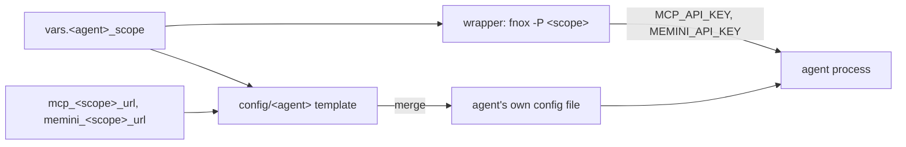
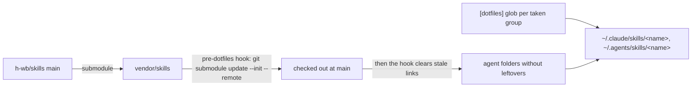

# ai

The tool and memory servers every agent connects to and its keys, defined once for every machine, and the skill groups every machine takes from [h-wb/skills](https://github.com/h-wb/skills). Which scope may reach what, and why, is the handbook's: [Workshop](https://github.com/h-wb/handbook/blob/main/Systems/Workshop.md), [Tool gateway](https://github.com/h-wb/handbook/blob/main/Systems/Tool%20gateway.md), [Agent memory](https://github.com/h-wb/handbook/blob/main/Systems/Agent%20memory.md). This page is how this folder renders it.

`mise.toml` is an env-less folder fragment, so it loads everywhere; a class file adds an agent's config where its path or key source differs.

```text
mise.toml              all machines: the scopes, Claude Code, Codex and Vibe (merged), the skill group every machine takes
mise.workstation.toml  workstations: public URLs, the agent wrappers, OpenCode's model gateway profile
mise.personal.toml     MacBook: Claude Desktop's config and the mcp-remote wrapper
mise.paseo.toml        Paseo pods: in-cluster URLs, OpenCode's config
fnox.toml              the agents' only secrets, one profile per scope plus OpenCode's
config/                the agents' config templates
```

## Scopes

Each agent's scope decides both its servers and its keys: a `*_scope` var in `mise.toml`, one fnox profile per scope.

| Scope | Agents | Rendered servers |
| --- | --- | --- |
| `general` | Claude Code, Claude Desktop, Codex | `toolhive` on the general gateway, `memini` on memini-general |
| `private` | Vibe | `toolhive` on the private gateway, `memini` on memini-private |



- Server names carry no scope (`toolhive`, `memini`): the URL says which. The templates render the same keys for every agent.
- memini is connected directly, not through the gateway: the gateway hides its tools behind `find_tool` and `call_tool`, and memory tools should be in view.
- Where the pod env has `MEMINI_GENERAL_URL` and a read-only `MEMINI_GENERAL_API_KEY` (home-ops gives both to the private pod), every agent gets a third server, `general_memory`: private agents read general memory and never write it.
- On the pods every agent takes the pod's scope (`PASEO_DATA_SCOPE`), and also gets `chrome-devtools` on the Chromium sidecar.
- OpenCode on a workstation gets no tool servers: its profile carries only the model gateway key.
- claude.ai (web, phone) is out of reach: its connectors call from Anthropic's cloud and want OAuth, and the gateways are internal with a static key.

Every agent file is a merge, so what the agent wrote itself stays. Renaming a rendered server therefore leaves the old one behind: remove it with the agent's own command (`claude mcp remove -s user <old>`, `codex mcp remove <old>`), not by editing the file. Vibe's servers are an array, which a merge replaces whole, so `config/vibe.toml` holds all of them: add one there, not with `vibe mcp add`.

## Domain

Never committed. Workstations build the public URLs from `SECRET_DOMAIN`, which `mise run apply`'s fnox resolves from Proton Pass (repo `fnox.toml`). Outside `apply` it is empty and the gateway and memini servers are left out; every agent file is merged, so that keeps what the last `apply` wrote. Do not add a default domain or a `[bootstrap.secrets]` entry for it: neko's `fresh` mode renders without secrets on purpose. The pods need no domain: they use in-cluster service names.

## Keys

No rendered file holds a key. Off the cluster, every agent reads its gateway key from `MCP_API_KEY` and memini's from `MEMINI_API_KEY`, whatever its scope.

- Workstations: mise `[wrappers]` for `claude`, `codex`, `vibe`, `opencode` and (MacBook) `mcp-remote` run them under `fnox -c conf.d/ai/fnox.toml -P <profile> exec`, so changing a scope moves servers and keys together. The wrappers intercept at PATH level, so a launch from a shell, a script, an IDE or launchd is covered alike ([docs/mise.md](../../docs/mise.md#behaviour-worth-knowing)).
- The explicit `-c` turns off fnox's directory search, so neither the repo's `fnox.toml` nor a project's reaches an agent. A global `~/.config/fnox/config.toml` would still load, so none is kept.
- Every profile defines every variable, so one the parent shell exports is always replaced; a variable a profile must not pass is `env = false`.
- For the scoped agents a missing or dead Proton Pass item fails only that server (`--if-missing warn`). OpenCode's profile uses `--if-missing error`, as without its key it has no model.
- Pods: no gateway key. They call the gateways' in-cluster services (`mcp_auth = "network"`), and home-ops admits only that scope's pod. `MEMINI_API_KEY` comes from the pod env. The addresses default to today's services and the pod env can set them (`TOOLHIVE_URL`, `MEMINI_BASE_URL`, `CHROME_CDP_URL`), so renaming a service needs no change here.
- Not covered: a client that runs its own bundled copy of an agent instead of the one on PATH.

Ruled out for passing keys: `[shell_alias]` (interactive shells only, not IDEs or launchd), Claude's `headersHelper` (Claude only), `fnox proxy` (starts the program itself, so not Desktop; intercepts all agent traffic; refuses the gateway's private address without `allow_private`), `fnox activate` (the keys in every shell's env).

## OpenCode on a workstation

Plain `opencode` uses the model gateway's HTTPS route for its built-in OpenAI catalogue, with its own virtual key in the password field of `Machines/litellm-workstation` (not checked). Remove any OpenAI account saved in OpenCode first, or it takes precedence. After `mise run apply`, set OpenCode to a private server on each workstation:

```sh
"$(mise which opencode)" service set disabled true
```

This stops the shared server; the wrapper resolves the key at each launch and the private server inherits it. Pairing needs the shared server and is unavailable in this mode. A key saved earlier in the shared service is cleared with `"$(mise which opencode)" service unset env LITELLM_API_KEY`. The model picker is not filtered by the gateway, so it lists models the key cannot use. Paseo keeps its own config and key.

## Skills

The skills are written once, in [h-wb/skills](https://github.com/h-wb/skills) (its README says how each harness takes them), and come in groups defined there: `groups/<group>/<name>`, a link to the skill. This repo holds the catalogue as the submodule `vendor/skills`, which follows h-wb/skills' `main`, and each place declares the groups it takes: one glob `[dotfiles]` entry per group and agent folder, `~/.claude/skills/*` (Claude Code) and `~/.agents/skills/*` (Codex, OpenCode, Vibe), `symlink` from `../../vendor/skills/groups/<group>/*`. Each skill of the group becomes one link; the same glob key in two files applies both. Only the skills of taken groups are linked; whatever else lives in those folders stays (Paseo installs its own skills there, and Claude keeps `synced`).

| Place | Takes | Skills today | In |
| --- | --- | --- | --- |
| every machine and pod | `core` | `handbook`, `board`, `tool-gateway` | `mise.toml` here |
| the Paseo pods also | `workshop` | `orchestrate`, `paseo-workspace-hygiene` | [paseo](../paseo/README.md) |



- A clone leaves a submodule empty and a pull does not move it, `mise bootstrap --from` on the pods included. So a `pre-dotfiles` hook in `mise.toml` runs `git submodule update --init --remote vendor/skills` before the links are made, on every bootstrap and `mise run apply`: the checkout is h-wb/skills' `main` as it is then. Offline it keeps the commit it has, or the one recorded here. The commit recorded in this repo is only that fallback. A tarball checkout (neko and code-server get the pinned commit as one) has no `.git` and an empty `vendor/skills`, so the hook clones the catalogue's `main` there, from the URL and branch in `.gitmodules`; offline that pod starts without shared skills. `.gitmodules` sets `ignore = all` on it, so a checkout ahead of that commit does not show as a change in `git status`.
- The same hook then removes broken links in `~/.claude/skills` and `~/.agents/skills`: mise leaves the link of a skill that left its group, `--prune-dotfiles` included.
- To add a skill to a group, or take it out, merge a pull request in h-wb/skills: workstations follow at their next `mise run apply`, pods at their next start. Nothing changes here. To take another group, add its two glob entries in the place's file.
- Groups need `mode = "symlink"`: their entries are links, and `symlink-each` over them fails with "Not a directory".
- A procedure for one repo lives in that repo (`.agents/skills/`); the assistant takes its own groups from h-wb/skills in home-ops, and its routines live there beside it.
- `test_skills_are_declared_from_the_catalogue` checks the declared groups and the front matter, `test_only_declared_skills_reach_the_agent_folders` that nothing else is linked, `test_group_changes_reach_the_folders_at_the_next_apply` that a skill joining a group arrives and one leaving leaves no link, `test_ai_skills_leave_other_skills_in_the_folder_alone` what stays, `test_a_fresh_clone_gets_the_catalogue_at_main` the update.

## What home-ops supplies

The pods run this repo's bootstrap at every start, so home-ops uses these definitions without copying them. It supplies only the inputs, `PASEO_DATA_SCOPE` and the URL and key variables, and keeps what is pod-specific in its own `config/` per scope: Paseo's providers (`paseo.json`) and OpenCode's models and providers (`opencode.json` through `OPENCODE_CONFIG`, layered over the global file rendered here; OpenCode merges both server lists). See [paseo/README.md](https://github.com/h-wb/home-ops/blob/main/kubernetes/apps/main/llm/paseo/README.md) in home-ops.
