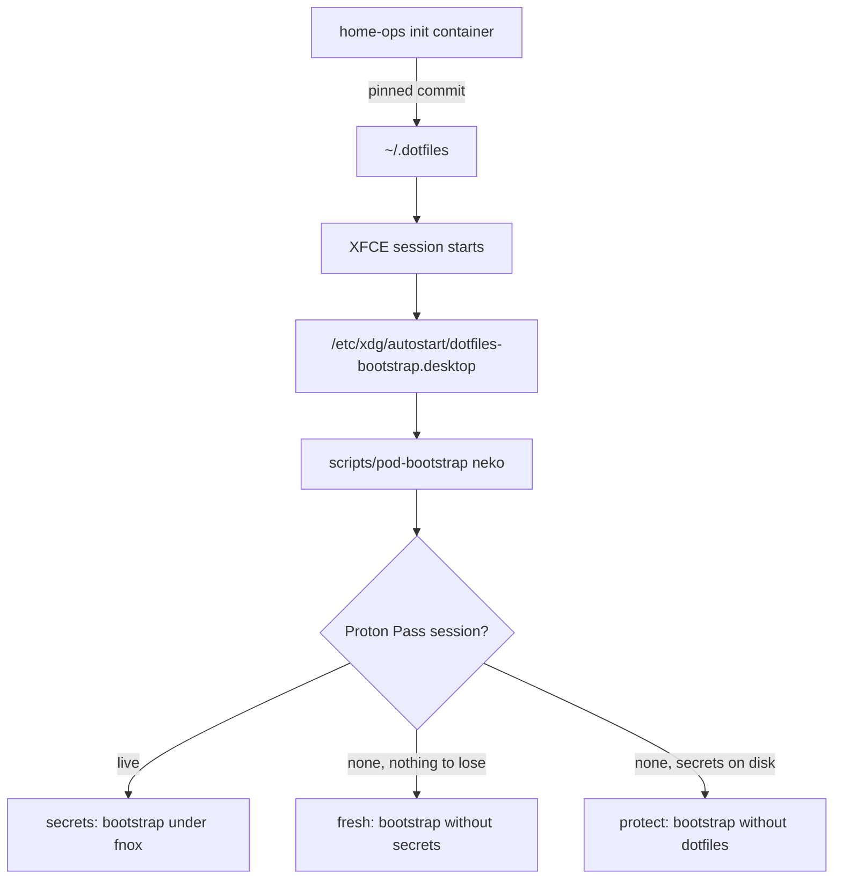

# The neko desktop

`ghcr.io/m1k1o/neko/xfce` in the cluster: Debian, user `neko`, passwordless sudo, supervisord as pid 1, so no systemd and no launchd. Class `neko` is layers `workstation`, `pod` and `fish` plus `conf.d/neko/`; `conf.d/neko-anki/` and `conf.d/neko-obsidian/` are its two apps. The pod itself is defined in home-ops.

## What survives

Only `/home/neko` is on a volume. `/usr` and `/etc` are wiped at every pod roll; never mount a volume over them (an empty `/usr` leaves no binaries).

- apt (`[bootstrap.packages]`) is reinstalled at every start, so the list stays short.
- GUI apps are `[tools]`, since `~/.local/share/mise` is on the volume. Not brew (it installs outside the volume, and Linux casks are fonts only), not apt (wiped), not flatpak (bubblewrap needs a user namespace, and a sandboxed VS Code cannot see the mise tools). Use `github:` or a pinned `http:` with a `[platforms]` table (an app whose GitHub "latest" is the wrong artifact).
- To add one: a `[tools]` entry in `mise.neko.toml`, a `.desktop` file in `xfce/applications/` and its `[dotfiles]` line. `Exec` is the mise shim, stable across bumps.
- The login shell and the time zone are image state, so `neko:shell` and `neko:tz` re-apply them at every run.

## Provisioning

- home-ops' `components/dotfiles` puts its pinned commit at `~/.dotfiles` before the desktop starts, and a system XFCE autostart entry runs `scripts/pod-bootstrap neko` inside the session (the launchd equivalent; `[bootstrap.linux.systemd.units]` is useless without systemd). It is the same script as code-server's ([code-server](../code-server/README.md#provisioning)): `--skip-dirty` (one dirty repo must not stop the desktop) and `--locked`, the log at `~/.local/state/pod-bootstrap.log`, the last start in doctor `pod-bootstrap`.
- `~/.dotfiles` is replaced at every start: edit this repo in `~/Repositories/dotfiles`, which layer `pod` clones.
- `fresh` is what gives a new volume its shell config. That is why the shared templates take no `[bootstrap.secrets]`: one missing secret would abort the whole run.
- The user autostart entry (`~/.config/autostart/mise-bootstrap.desktop`) and `~/.local/bin/neko-bootstrap` that launched the bootstrap before the pin are `absent` entries in `mise.neko.toml`; drop them once every neko volume has applied them.
- `xfconf-query` needs the session D-Bus: it works from the autostart run and does nothing from `kubectl exec`.
- pass-cli keeps its key in the kernel keyring by default, which the pod's seccomp blocks. Layer `pod` sets `PROTON_PASS_KEY_PROVIDER=fs`, keeping it on the volume, and a session-start run logs in from `PASS_CLI_PAT`. Never set `seccompProfile: Unconfined`.
- The volume is `reclaimPolicy: Delete` under a pruning Flux Kustomization in home-ops; its only backstop is the daily backup to the NAS defined there (not checked from here).

## Anki

`conf.d/neko-anki/`. supervisord keeps Anki running so n8n reaches AnkiConnect on `:8765` and the tool gateway reaches the AnkiMCP add-on on `:3141`; home-ops has both Services. `anki:setup` is `anki:addon` (links both add-ons, writes their `meta.json`) then `anki:start` (`supervisorctl update anki`).

- Bind `0.0.0.0` only with a key: Proton Pass `Machines/anki-connect` and `Machines/anki-mcp`, the second also in the `toolhive` Bitwarden secret as `ANKIMCP_API_KEY`.
- `update_enabled: false`, or Anki's updater deletes the linked add-on.
- AnkiMCP's `http_allowed_hosts` lists the Service name the gateway dials; any other host gets a 421 (a wrong key is a 403).
- The `.ankiaddon` tool entry needs `format = "zip"`.
- Doctor: `anki-connect`, `anki-mcp`.

## Obsidian

`conf.d/neko-obsidian/`. Kept running the same way, so n8n can read and write the [notes vault](https://github.com/h-wb/handbook/blob/main/Systems/Notes%20vault.md) through the Local REST API plugin on `:27124` (home-ops' `neko-obsidian` Service). Never write vault files from outside Obsidian: Sync uploads only what its own watcher sees. The vault and its plugins, with the plugin's `bindingHost: 0.0.0.0` and key, come from Obsidian Sync, not from here; doctor `obsidian-rest-api` checks the result.
