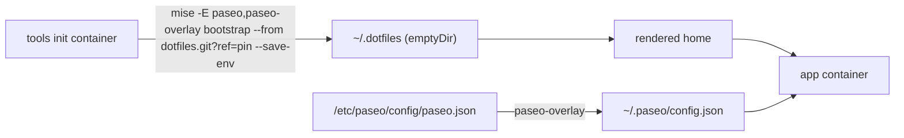

# The Paseo pods

The [workshops](https://github.com/h-wb/handbook/blob/main/Systems/Workshop.md): one pod per scope, general and private. Both declare the same environment, `paseo,paseo-overlay`, and `PASEO_DATA_SCOPE` names the scope. They load no `workstation` layer, so no kubeconfigs, credentialed CLIs or `apply` tasks. How the pods are built, what each can reach and how scopes are kept apart is home-ops': [paseo/README.md](https://github.com/h-wb/home-ops/blob/main/kubernetes/apps/main/llm/paseo/README.md).

## What this class gives them

- The agents' tool and memory servers, from `conf.d/ai/mise.paseo.toml` like on every machine: the scope's gateway, its memini and the Chromium sidecar's `chrome-devtools` ([ai](../ai/README.md)).
- The skills only a pod can use: `mise.paseo.toml` takes the `workshop` group of [h-wb/skills](https://github.com/h-wb/skills) (`orchestrate`, `paseo-workspace-hygiene` today), beside the `core` group every machine takes, in the same two folders ([ai](../ai/README.md#skills)). The private pod takes it too.
- CLIs (node 24 from `config.toml`, as 26 needs a library the image lacks), the repos agents work on in `~/Repositories`, `bashrc` and the starship prompt. `trusted_config_paths` covers `~/Repositories` and `~/.paseo/worktrees`, since an untrusted repo config fails every shim run.
- `[bootstrap.repos]` with a `ref` are put back on their base branch at every start when clean, as agents work in Paseo worktrees. A `ref` makes the init container fetch, so only public repos have one.
- Git identity: the general pod commits as the bot, the private pod as the owner.
- Proton Pass: one session per scope, `paseo-<scope>`, logged in by `paseo:pass-login`, which extends the shared template ([proton-pass](../proton-pass/README.md)).

## Provisioning

- home-ops' `tools` init container runs `mise -E paseo,paseo-overlay bootstrap --from <dotfiles.git>?ref=$DOTFILES_REF --save-env --from-dir ~/.dotfiles --config-dir . --yes --force-dotfiles --skip-dirty --locked`, with no script; a failure logs a line and the pod starts. `--save-env` writes the declaration into the checkout for the app container. The private pod adds `--skip=repos,task`, so it clones no repos and runs no login.
- The clone leaves the `vendor/skills` submodule empty; the `pre-dotfiles` hook in `conf.d/ai` brings it to h-wb/skills main and removes broken skill links before the groups are linked, so the init container needs GitHub (it has it for the clone). The private pod skips `repos`, not `dotfiles`, so it runs the hook too.
- `~/.dotfiles` is an `emptyDir`, cloned fresh at `DOTFILES_REF` at every start and read-only in the app container, because `--update` only fast-forwards: an agent's commit there once blocked the pod. Edit dotfiles in `~/Repositories/dotfiles`, in a Paseo worktree.
- Shims link to the mise that made them, so mise is the jdx/mise image mounted at `/opt/mise` in every container, first on `PATH`. The image tag is the mise version: keep it at or above `min_version`.
- Never set `MISE_CONFIG_DIR=~/.dotfiles` there: through the real directory, mise rewrites the lock sidecar paths, and the checkout is read-only anyway. The link is enough.
- `paseo-overlay` is its own layer, declared by the pods, because a merge with a missing source is an error. It merges that file into `~/.paseo/config.json`. That path, `PASEO_DATA_SCOPE` and the URL and key variables are the whole contract with home-ops.
- No sshd: terminals come from Paseo, admin shells from `kubectl exec`.
