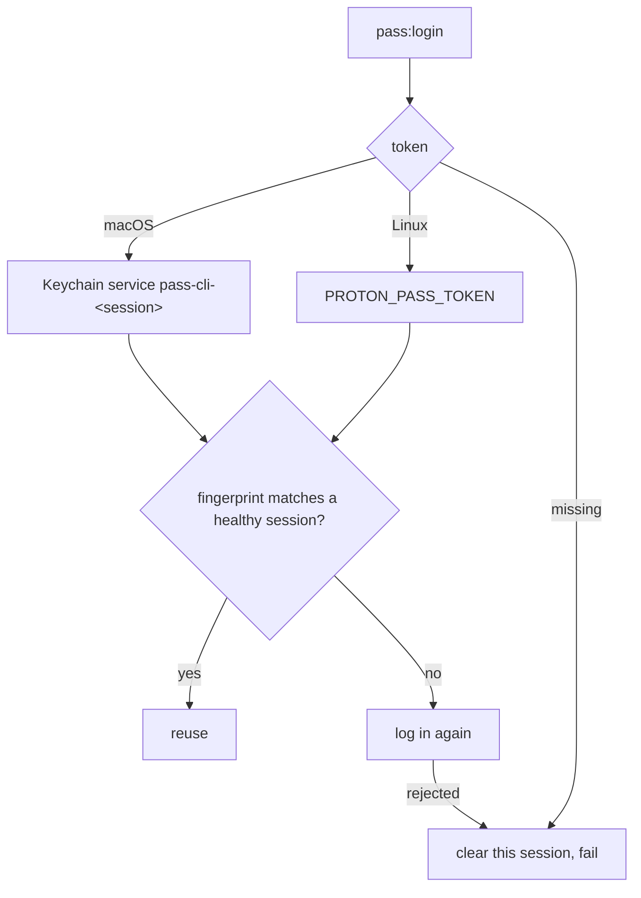

# Managed Proton Pass sessions

This folder defines the global `proton-login` mise task template and the `proton:login` task, loaded on every machine class. Repositories extend the template instead of writing their own login:

```toml
[env]
PROTON_PASS_SESSION_DIR = "{{env.HOME}}/.local/state/pass-cli/home-ops"

[tasks."pass:login"]
extends = "proton-login"
env.PROTON_PASS_LOGIN_SESSION = "home-ops"

[tasks.deploy]
depends = ["pass:login"]
# secrets = [...]  # resolved only when deploy starts, after authentication
run = "..."
```

Run `mise run pass:login` in the repository. To log a named session in from anywhere, `mise -C ~ run proton:login home-ops`.



- The session name selects `$HOME/.local/state/pass-cli/<session>` and, on macOS, the `pass-cli-<session>` Keychain service of the current user. Linux uses `PROTON_PASS_TOKEN` from the pod environment. Tokens are never task arguments, and a failed Keychain lookup never falls back to another environment's token.
- The task fingerprints the selected token, reuses a matching healthy session, and logs in again on rotation or expiry. Missing or rejected credentials clear that named session and fail the task; other sessions are left alone.
- Secret-consuming tasks depend on login, so the credential is checked before fnox fetches their secrets.
- The template holds a machine-wide task lock, `proton-pass-login`, which every task extending it inherits: two agents logging in at once take turns instead of clearing a session under each other.
- This manages cached authentication only. Token grants define access: separate session directories do not narrow a shared token. Revoke a superseded token in Proton Pass too.

`scripts/pass-preflight` is separate: the workstation's interactive account login before `mise run apply`. It tries the stored session, then `PASS_CLI_PAT` (no terminal needed), then `pass-cli login` unless `DOTFILES_NO_LOGIN` is set or there is no terminal. It does not use these named sessions.

Do not add repository-specific login scripts, item grants, share or item ID maps, per-scope fnox profiles for a repo, or another login implementation.

## Vaults: named by who reads them

The layout below is kept in Proton Pass itself (not checked from here).

| Vault | Read by | Holds |
| --- | --- | --- |
| `Personal` | the owner | personal logins |
| `Homelab` | the owner | homelab service web logins |
| `Machines` | the owner's machines' dotfiles and CLIs | kubeconfigs, SSH, WireGuard, the GitHub workstation token, agent gateway keys, Anki |
| `Automation General` | the general Paseo pod, plus the workstation tokens of the repos it works on | everything agents read: home-ops bootstrap and Talos, pipelines, and the other repos the general pod works on |
| `Aliases` | the alias service | email aliases |

- If an agent may read an item, it lives in `Automation General`. If a machine needs it, `Machines`. Everything else is the owner's. An item two readers need goes in the narrower reader's vault, and the broader token gets a grant on it too. No folders.
- The private pod needs no secret today, so it has no vault. The day it does, that vault is `Agents Private`.
- Each token gets a vault grant, so every repo keeps one readable map (`pass://Automation General/talos-cluster/token`). Machine item names are lowercase kebab-case (`github-workstation`, `kubernetes-gateway`); `toolhive` and `memini` keep one field per scope (`general`, `private`; see `conf.d/ai/fnox.toml`).
- Routine agent tokens are viewer only. Reorganising items takes a short-lived token with write grants, never installed as a workload's runtime token. An agent session cannot manage grants: they are given from the owner's own session.
