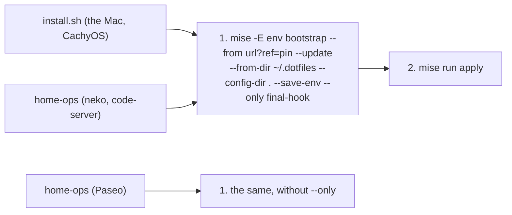
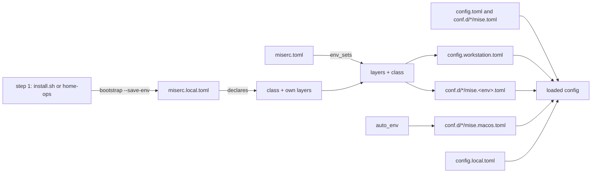

# How this repo uses mise

mise does everything here: tools, packages, dotfiles, services, settings and tasks. This page is the mechanics; what each machine holds is on its own page, listed in the [README](../README.md#layout).

## The repo is mise's config directory

`~/.config/mise` is a symlink to `~/.dotfiles`, so mise reads every file under its native name and every relative path resolves inside the repo. The link is the first `[dotfiles]` entry in `config.toml`. Its source is the absolute `~/.dotfiles`: a relative one would resolve through the link to itself.

## One bootstrap, two steps

Every machine runs the same two steps; only who runs them differs.

1. **The checkout.** `mise bootstrap --from` clones the repo to `~/.dotfiles` or reuses the clone there, links `~/.config/mise` to it (`--config-dir .`) and saves the declared environment (`--save-env`). `--only final-hook` keeps it from applying anything else. A pin is `?ref=<commit>` with `--update`: mise checks the commit out, forward or back, and stops on a local change that would be overwritten. With neither, an existing clone stays as it is, branch and local work included. mise reuses a clone only when its origin is exactly the `--from` URL, so `install.sh` passes the clone's own.
2. **The apply.** `mise run apply` (layer `workstation`, `scripts/apply`) is the one bootstrap with secrets: the Proton Pass preflight, then `fnox --if-missing error exec -- mise bootstrap`. A person without a session stops there. A pod passes `--unattended`: without a session it still applies what needs no secret (`fresh` on a new volume, `protect`, without dotfiles, once secrets are on disk) and reports it. Every run leaves `~/.local/state/dotfiles.status`, `RESULT MODE DATE COMMIT`; on the pods doctor `pod-start` reads it. `mise run` installs the machine's tools before the task starts, fnox and pass-cli included.

The Paseo pods hold no secrets, so their step 1 applies everything and there is no step 2. neko's step 2 runs in its desktop session, because apt and xfconf need it.

After the first run the link exists, and `mise run apply`, `diff` and `upgrade` work through it. The `[dotfiles]` entry keeps it like any dotfile (`mise dot status` shows drift; a real directory in the way needs `--force-dotfiles`). Never set `MISE_CONFIG_DIR=~/.dotfiles` on a pod ([paseo](../conf.d/paseo/README.md)).

## How a machine picks its files

The machine's environment is declared, never detected. The caller names it and mise's own `bootstrap --save-env` writes the untracked `miserc.local.toml`, before it applies anything, so a failed run still leaves the declaration:

- `install.sh` from `DOTFILES_ENV` (the Mac, CachyOS): required on the first run, kept after.
- home-ops from each pod's `DOTFILES_ENV` (neko, code-server, `paseo,paseo-overlay`).

A declaration is one set from `miserc.toml`'s `[env_sets]`, which expands it into its layers, then any layers for that machine only (`paseo-overlay`). mise saves any name, so `install.sh` checks that the first one is a set, and it unsets an inherited `MISE_ENV` so an activated shell's never wins. CI declares each matrix job the same way, and `mise -E neko` selects a machine for one command. A machine that declares nothing gets `config.toml` and the shared folders only, and doctor `wiring` fails; `home/git/config.tmpl` reads `mise_env` with a default for it.

| File | Loads |
| --- | --- |
| `config.toml` | always: what every machine wants, the paseo pods included |
| `config.workstation.toml` | layer `workstation` |
| `conf.d/<folder>/mise.toml` | always |
| `conf.d/<folder>/mise.<env>.toml` | that class or layer, or that platform (`macos` is any Mac) |
| `config.local.toml` | always, last: untracked per-machine `[vars]` |
| `miserc.toml` | early init: each class's layers (`[env_sets]`) |
| `miserc.local.toml` | early init, untracked: the declared environment |

- A `conf.d/` folder reads only `mise.toml`, `mise.local.toml`, `mise.<env>.toml` and `mise.<env>.local.toml`, one level deep. Relative sources resolve inside the folder and its tasks run there.
- A folder's name says where it loads: a machine is named like its environment (`neko/`), a feature only one machine has is `<machine>-<feature>/` (`neko-anki/`), and a name with no machine in it loads on several (`ai/`, `proton-pass/`, the layers `pod/`, `nonroot/` and `fish/`). `test_conf_d_folder_names_say_where_they_load` holds the names to this. A feature gets its own folder when it has its own files, tasks or doctor checks.
- Renaming a folder moves its symlink sources: the old links dangle until the next apply re-points them. On the Mac apply right after pulling (`~/.zshrc` is one of them); a pod's start does it, except in `protect` mode. Never rename the `apply` task or its `--unattended` flag: home-ops runs them.
- `home/` holds the sources of the root configs (git, ssh, kube). A folder fragment never reaches into it.
- Platform envs (`auto_env = true`): `macos`, `linux`, `unix`, `<os>-<arch>` are active by themselves, below explicit envs. `[tools]` and `[bootstrap.packages]` still take `os =` for an odd entry (neko's GUI apps keep it, so a stray `-E neko` on a Mac fails clean).
- Layers never set the same key as each other, so their order cannot change the result.

## The minimum version

`min_version = { hard = "2026.11.1" }` in `config.toml`: the first release that expands `[env_sets]`. An older mise loads a declared class without its layers, silently. Every pod runs mise from the `ghcr.io/jdx/mise` image, so its tag (Renovate) must stay at or above it. On the Mac and CachyOS mise refuses to load the config below it and says so: `mise self-update`, or `mise run upgrade`. Do not raise it to a release less than a day old: self-update and mise-action both wait a day.

## Checks

- `mise doctor project` runs the `[doctor.checks.*]`: `wiring`, `config-keys`, `file-modes`, `lockfiles`, `tasks`, `credential-perms`, plus each machine's own. `config-keys` exempts exactly three deprecations, `bootstrap.macos.defaults`, `defaults_entries` and `login_items`: mise 2026.11.8 deprecates them for `[bootstrap.settings.macos]`, which is experimental and unknown to the minimum version, so no file passes on both. `file-modes` skips `vendor/`, the skills submodule. Fields are `description`, `run`, `hint` and `depends`; the first three are Tera templates, so a literal `{{` needs ``. A check whose `depends` fails is blocked, not run. Add a check whenever a regression was caught by hand.
- `mise config explain --file <f>` names every key and flags unknown and deprecated ones. mise only warns on an unknown key, so a typo is a silent no-op; doctor `config-keys` runs it over every committed config.
- `mise tasks info <task>` renders a task without running it. CI does it for every task, hidden ones included.

## Lockfiles

mise writes one lockfile per config file, all in the repo: `mise.lock` (`config.toml` and env-less folder fragments), then one per env (`mise.macos.lock`, `mise.workstation.lock`, `mise.personal.lock`, `mise.neko.lock`, `mise.cachyos.lock`, `mise.paseo.lock`, `mise.nonroot.lock`, `mise.fish.lock`, `mise.code-server.lock`). Format version 3.

- Each env lockfile lists only the platforms that env runs on: `macos` and `personal` macos-arm64, `cachyos` and `paseo` linux-x64, `neko`, `nonroot`, `fish` and `code-server` linux-x64 and arm64, `workstation` macos-arm64 and both Linux; `mise.lock` keeps them all. A plain `mise lock --global` keeps each file's set. `--platform` applies to every loaded lockfile, so it adds entries where they do not belong (locking an AppImage-only tool for arm64 once picked a different artifact): check `git diff mise*.lock` after any lock.
- Dependency sidecars live in `locks/`. Commit the paths `mise lock --global --sidecars` prints, with the lockfiles.
- Doctor `lockfiles` is `mise install --locked --dry-run` for the active platform. A locked PyPI graph needs its Python installed even for that, so CI installs Python and uv first.
- `http:` tools are pinned by hand: bump the version and every URL, then lock.
- `latest` tools move on `mise run upgrade`: commit the lockfiles it changes.

## Behaviour worth knowing

Each of these was checked against mise and has bitten this repo once.

- Task fields (`dir`, `run`, `env`) are Tera templates, comments included: a malformed `{{ }}` in a `#` comment fails the task.
- Templated: task fields, dotfile content (`mode = "template"`), `[bootstrap.files]` content with `template = true`, launchd and systemd values, hook commands, `[shell_alias]`, doctor fields. Literal: every key (so a `[bootstrap.files]` path cannot come from a secret), dotfile `source`, package specs, macOS defaults.
- Inline task and hook bodies run under `sh -o errexit`: an assignment from a failing command substitution ends the body there. End it with `|| true` when empty is an answer.
- A machine's `[tasks.bootstrap]`, run last by `mise bootstrap`, is a sequential `run = [{ task = "..." }]` list of small tasks with `skip_if` guards; internal ones are `hide = true`. Bodies longer than a few lines are scripts in the folder's `tasks/` (`run = "sh tasks/x.sh"`, committed non-executable). `bin/` holds only what goes in `~/.local/bin`.
- Task arguments need a `usage` spec: without one, `mise run t foo` appends `foo` to the last line of a multi-line script. With one, it is `{{ usage.x }}` (`--dry-run` is `usage.dry_run`). A nested `mise run` keeps the terminal, so `diff` calling `apply --dry-run` still lets `pass-cli login` prompt.
- Same-named hooks accumulate across configs; same-named tasks override.
- `{{ config_root }}` in a folder fragment is the folder, doctor checks included. Task templates are the exception: they render in the extending task's project, hence `mise_config_dir` in `proton-pass`.
- Hooks fire on a full `mise bootstrap` and with `--only <step>`, not for sub-commands like `mise bootstrap macos defaults apply`.
- A hook that writes a file the dotfiles step renders is overwritten by it. What must stick goes in the source template.
- `[dotfiles]` never uses sudo. `[bootstrap.files]` is the only way to write a root-owned path; keys are absolute, and it takes `os =` but no `variants`.
- `permissions = "0600"` sets and repairs a target's mode (git records only the executable bit). It works on template, copy and content entries, not symlinks; an entry with only `permissions` never creates the path.
- `mode = "absent"` removes a target a refactor orphaned. Drop the entry once every machine has applied it.
- A var that reads another var is resolved in the file that defines it: overriding `x` higher up does not move `y = "{{ vars.x }}"`. Build a derived string where it is used.
- `[vars]` cannot hold nested tables; `[vars.x]` is only the var's own definition (`default`, `prompt`, `required`).
- `mise vars x=VALUE` saves a per-machine value in `$MISE_STATE_DIR/vars.toml`. Precedence, highest first: an env var named exactly like the var, any config file that sets it, the saved answer, the `default`. A plain `x = "..."` always beats a saved answer, so a saveable var is the table form with `default`.
- mise's `[env]` does not feed `get_env()`, which reads the real process env. That is why templates read `[vars]` that default to `get_env(...)`. String `[vars]` overrides in an env file work; boolean ones do not.
- `mise env` in a `#!/bin/sh` script needs `--shell bash`: from fish it emits `set -gx`, on which dash exits.
- A `merge = true` edit deep-merges tables but replaces arrays whole.
- `[wrappers.<bin>]` intercept a binary at PATH level, through its shim and `mise activate`'s wrapper dir, even from a bare launchd environment. `args` are inserted before the caller's, so they end with `--`, `<bin>`. This is how an agent gets fnox secrets everywhere ([ai](../conf.d/ai/README.md#keys)).
- `[shell_alias]` is set by `mise activate` (zsh, bash, fish), templated without `vars`, and absent from tasks and `mise exec`.
- Bare `mise bootstrap` applies. Use `--dry-run` to look; a dry run does not render dotfile templates.

## Test a change without touching the machine

- Build a sandbox `HOME` whose `.config/mise` links to a copy or worktree, and run from a directory inside it. From `~/.dotfiles`, mise walks up to the live `~/.config/mise` and loads it on top.
- `[bootstrap.files]` apply for real even in a test: retarget the entry first. CI retargets in place, as runners have passwordless sudo.
- LaunchAgents and login items: `--dry-run` only. launchd's domain is the logged-in user, not `$HOME`, so an apply from a sandbox replaces the real `dev.mise.*` agents.
- Linux without the CachyOS box: a temporary mise in `/tmp` with `MISE_CONFIG_DIR=/tmp/<copy>` on the neko pod. From a Mac, tar with `COPYFILE_DISABLE=1 tar --no-mac-metadata`, or `._*` files ship too.

## Not used, and why

| Option | Why not |
| --- | --- |
| `bootstrap --update` on a branch, or any pull | Nothing here follows a branch. A person updates the Mac's or CachyOS's clone with git; on the pods `--update` only moves the checkout to the commit home-ops pins (`DOTFILES_REF`, bumped by Renovate). |
| `--adopt` (clone into `~/.config/mise`) | Runs bootstrap without fnox and moves the checkout off `~/.dotfiles`. |
| `mode = "track"`, `mise dot track ~/.config/mise` | A second history over files the git checkout already is, without a rendering step, so rendered secrets would enter it. |
| An extra env as a toggle (`env = ["personal", "edge"]` for DNS) | `MISE_ENV` order is last-wins, so `["edge", "personal"]` silently picks main. The DNS choice is a saved var instead ([macOS](../conf.d/macos/README.md#cluster-dns)). |
| `[bootstrap.secrets]` for the shared templates | A missing secret aborts the whole bootstrap, and a fresh neko volume is provisioned without secrets on purpose ([neko](../conf.d/neko/README.md)). It is used only where an empty value would break something: the Mac's resolver and collector config. |
| `remove_empty = true` on a secret-gated template | A dead session would delete `~/.ssh/config` instead of blanking it. |
| `mode = "fnox"` for kubeconfigs and WireGuard | fnox keeps such files in its global config, and none is kept on purpose: it would load under every agent wrapper. |
| Task caching | Provisioning depends on machine state that file timestamps cannot vouch for. |
| Dotfile groups | They group files by directory tree, not config by machine; folder names already do that. |
| `mise bootstrap plan` | Leaves out dotfiles, tools, hooks, repos and defaults, so the full dry run stays. |
| Unprefixed `[bootstrap.packages]` keys | Each class has one package manager and its own file; the prefix costs nothing. |
| chezmoi | Replaced by mise. Never run `chezmoi apply`. |
